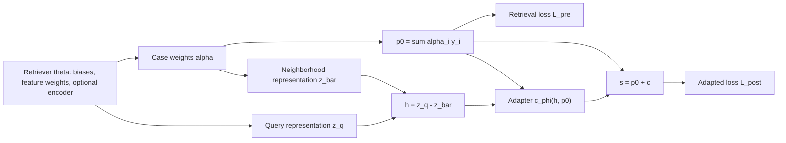

# T1 joint-loss computation-graph audit

October 30, 2026. This is a code/derivative audit with small synthetic fixtures, not a benchmark or a convergence claim.

## Main result

Post-adaptation loss differentiates through the adapter inputs and the direct residual connection into retrieval parameters. Retrieval-only loss does not depend on adapter parameters: its gradient with respect to the adapter is exactly zero. Both joint modes implement their stated gradient routing, and the training loop steps both optimizers. No unintended detach was found in the ordinary synchronized prediction path.

This means retrieval updates can change adapted loss, and adapter updates can change adapted loss. Adapter updates alone cannot change the retrieval-only loss. They can change the signal that the post-adaptation objective sends to retrieval on later updates.

## Forward graph

Let theta be retrieval parameters and phi be adapter parameters. For regression:



The adapter does not feed back into p0. Shared MLP training differentiates through both query and stored-case encoder branches. With EMA/MCB, the stored-case encoder is intentionally a no-gradient target; the online query encoder remains differentiable. Raw-feature runs still train retrieval biases and feature weights even though the raw input features require no gradients.

Classification has the same dependency structure: p0 is retrieved class mass; the nominal adapter returns `c = tanh(g_phi(h, p0))` and `s = p0 + c`; post-adaptation loss is cross-entropy of `score_scale * s`. The nominal scores are not the same distribution as p0, even when the correction is zero. Optional declared nominal differences add inputs without creating an adapter-to-p0 path.

Source: [synchronized terms and backward](../../../../model/t1/sync.py), [aggregate and classification adapters](../../../../model/nn_cdh.py), and [retrieval/encoder implementation](../../../../model/nnknn_model.py).

## Chain rule, one scalar regression prediction

```text
p0 = p0(theta)
h  = h(theta)
c  = c_phi(h, p0)
s  = p0 + c

L_pre  = (p0 - y)^2
L_post = (s - y)^2

ds/dtheta = (1 + dc/dp0) * dp0/dtheta + (dc/dh) * dh/dtheta
ds/dphi   = dc/dphi

dL_post/dtheta = 2*(s-y) * ds/dtheta
dL_post/dphi   = 2*(s-y) * dc/dphi
dL_pre/dphi   = 0
```

The batch implementation averages these derivatives. The first two derivatives are generally nonzero; they can nevertheless vanish or become weak because of saturation, inactive units, cancellation, or masking. In particular, if the adapter learns to cancel p0, the factor `1 + dc/dp0` can become small.

## Exact objective and routing

```text
L_R = w_pre*L_pre + w_post*L_post + w_near*L_near
L_A = v_post*L_post + v_delta*L_delta + v_small*L_small
```

- `summed`: both parameter groups receive the gradient of `L_R + L_A`. Algebraically the total is `w_pre*L_pre + (w_post+v_post)*L_post + w_near*L_near + v_delta*L_delta + v_small*L_small`. Terms independent of a group contribute zero to that group's gradient.
- `separated`: retrieval receives only `grad_theta(L_R)` and the adapter only `grad_phi(L_A)`. Post-adaptation loss still propagates through the adapter into retrieval; freezing adapter parameters does not detach its inputs. This is component-specific routing, rather than the gradient of the summed scalar objective for both groups.

In regression, the current residual definition gives an exact redundancy:

```text
L_delta = MSE(s-p0, y-p0)
        = mean(((s-p0)-(y-p0))^2)
        = mean((s-y)^2)
        = L_post
```

Both targets and predictions retain their graph dependencies, so this identity holds for both component gradients as well. With the Student Performance/global F weights `w_pre=1, w_post=0.5, v_post=1, v_delta=1, v_small=0.1, w_near=0`, summed mode therefore optimizes:

```text
L_total = L_pre + 2.5*L_post + 0.1*L_small
```

In separated mode, retrieval instead receives `grad_theta(L_pre + 0.5*L_post)` for those weights, while the adapter receives `grad_phi(2*L_post + 0.1*L_small)`. Thus the choice changes effective weights and routing, not merely the label of the schedule.

For nominal-residual classification, `L_delta = MSE(c, one_hot(y)-p0) = MSE(s, one_hot(y))`, a score-level squared error. It differs from post-adaptation cross-entropy; it is not a second independent retrieval-only objective. Cross-entropy's score scale also affects gradient magnitudes.

## Numerical checks

The [audit runner](runner_at_execution.py) uses 12 fixtures: classification/regression x raw/shared MLP/EMA MLP x mask on/off. Regression synthetic data and preprocessing use `model.regression_workflow`. All checks passed:

- Retrieval-only loss has zero adapter gradient in all 12 fixtures.
- Post-adaptation loss has nonzero retrieval and adapter gradients in all 12 fixtures.
- Directional finite differences confirm the post-loss retrieval gradient while preserving mask membership. Maximum accepted relative discrepancy: approximately 0.0635%.
- Summed and separated backward operations match independently assembled autograd objectives.
- Regression residual loss equals post loss in value and gradients; classification residual loss equals MSE of nominal scores against one-hot labels.
- Retrieval-only small gradient steps lower adapted loss; adapter-only steps lower adapted loss and leave retrieval loss unchanged; sufficiently small joint steps lower total loss in all fixtures. Step sizes use a predefined backtracking list, not a benchmark tuning procedure.
- Optimizer groups cover the intended trainable parameters, and a fresh Adam step changes both retrieval and adapter parameters. Total loss decreases on that one step in all 12 fixtures. This does not guarantee monotonic behavior with accumulated momentum or later training.
- The ordinary initialized fixtures had aligned pre/post retrieval gradients; this audit does not claim to have observed gradient conflict there.

The relevant existing joint-gradient, synchronized-regression, chunking and shared-core tests also pass: **64 passed**. This is a targeted check, not a claim that the entire branch suite is passing. [Audit values](audit.json), [manifest](manifest.json).

## Constructed counterexample: correct gradients can sacrifice retrieval

[counterexample.py](counterexample.py) fixes synthetic query targets to the retriever's initial predictions, making `L_pre=0`, and initializes the actual aggregate adapter to correction +1. The retrieval-only gradient is zero at that point, but post-adaptation loss still has a nonzero retrieval gradient. One small normalized total-gradient step gives:

| Quantity | Before | After |
| --- | ---: | ---: |
| Retrieval MSE | 0 | 4.4594e-9 |
| Adapted MSE | 1 | 0.997937 |
| Total loss | 2.5 | 2.494843 |

The total falls while retrieval worsens, despite correct backpropagation and a retrieval term in the loss. The small deterioration is expected for a tiny step away from an exact optimum. This is a deliberately constructed graph example, not an observed dataset result. [Exact values](counterexample.json).

More generally, near a minimum of `L_pre`, its gradient is approximately zero. The post-adaptation gradient can move retrieval away from that point before the retrieval term supplies a restoring gradient. A weighted sum permits such tradeoffs. Finite learning rates, Adam momentum, different learning rates, changing Top-K membership, and validation selection add further reasons that neither component loss nor test error must decrease at every step. Global convergence is not established by a connected graph or a local descent check.

## Point 1 connection: probability-floor plateau

A separate constructed classification query has no true-class case in its Top-2 neighborhood. Its masked retrieval NLL is 18.420681, yet the retrieval gradient from `L_pre` is zero because the true-class probability is clamped at the 1e-8 floor. The post loss still supplies a nonzero retrieval gradient. Without the mask, retrieval NLL is 3.281298 and its retrieval gradient norm is 2.092025. This is a condition-specific example, not a claim that all masked queries have zero gradients; probability flooring or numerical underflow can also limit unmasked queries. [Values](audit.json).

## Assessment

The synchronized prediction graph is connected for the intended joint optimization. The interaction is asymmetric: adaptation loss trains retrieval, but adaptation parameters do not directly reduce retrieval-only loss. The existing combined loss is a valid weighted objective, not a guarantee of retrieval preservation. Regression's duplicated residual/post loss changes the effective tradeoff. A useful follow-up should therefore specify weights, routing, or a retrieval constraint, rather than merely add an already-present retrieval term. No shared implementation was changed by this audit.
